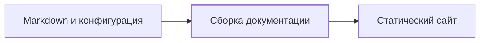

Один проект · один понятный сайт

# Quokki · demo

Небольшой пример документации, подключённой к общему движку.

## О demo {#overview}

Этот минимальный проект показывает подключение движка docs-kit к обычной
Markdown-документации. В demo нет отдельного приложения: его содержимое —
конфигурация сайта и страницы, которые движок превращает в статику.

### [Сборка документации](components/build.md) {#start-build}

От исходных страниц и конфигурации до готовой статики.

### [Путь контента](#documentation-flow) {#start-flow}

Посмотрите, какую работу выполняет проект, а какую — движок.

### [Подробные ограничения](#reader-details) {#start-details}

Проверьте границы стенда и доступ к полному содержанию.

## Путь документации {#documentation-flow}

Движок получает конфигурацию проекта, Markdown и собственную тему. Результат
можно открыть на локальном HTTP-сервере или опубликовать на GitHub Pages.

## Детали реализации {#reader-details}

Контент остаётся доступным без JavaScript. Этот режим открывает все уровни
страницы; для чтения готового HTML сервер приложения не требуется.

`docs-kit.toml` задаёт название, описание и навигацию. Контент хранится в
`docs/`. Скрипты и тема находятся в репозитории движка и не копируются в
исходники demo. Сгенерированная статика не является исходником документации.

Анализ кода, генерация модели, docs-check, журнал и статистика не входят в
этот demo. Это запланированные возможности последующих фаз.

