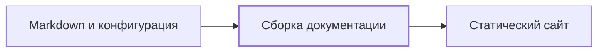

# docs-kit demo

## Обзор

Этот минимальный проект показывает подключение движка docs-kit к обычной
Markdown-документации. В demo нет отдельного приложения: его содержимое —
конфигурация сайта и страницы, которые движок превращает в статику.

[Сборка документации](components/build.md) описывает путь от исходных файлов
до готового сайта.

## Как устроено

Движок получает конфигурацию проекта, Markdown и собственную тему. Результат
можно открыть на локальном HTTP-сервере или опубликовать на GitHub Pages.

## Детали

`docs-kit.toml` задаёт название, описание и навигацию. Контент хранится в
`docs/`. Скрипты и тема находятся в репозитории движка и не копируются в
исходники demo. Сгенерированная статика не является исходником документации.

Анализ кода, генерация модели, docs-check, журнал и статистика не входят в
этот стенд фазы 1.

