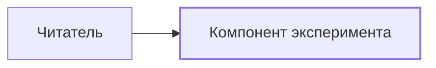

# Эксперимент фазы 0

Это проверочный стенд Zensical, а не готовый движок docs-kit.
Он проверяет формат контента и возможность браузерных расширений.

<div class="level-control" role="group" aria-label="Глубина документации" hidden>
<button type="button" data-level="1" aria-pressed="false">Обзор</button>
<button type="button" data-level="2" aria-pressed="false">Как устроено</button>
<button type="button" data-level="3" aria-pressed="false">Детали</button>
</div>

<div class="lvl lvl-1" markdown>

## Обзор

**Markdown с голым атрибутом:** этот текст должен быть жирным.

- Список должен стать HTML-списком.
- [Страница компонента](components/probe.md) проверяет переход и сохранение уровня.

</div>

<div class="lvl lvl-2" markdown="1">

## Как устроено

Диаграмма связывает стенд и его компонент. Узел компонента должен быть кликабельным.



</div>

<div class="lvl lvl-3" markdown="block">

## Детали

Проверяется и явно заданный `markdown="block"`.

```python
print("phase 0")
```

Этот стенд не содержит генератора модели, docs-check, журнала или публикации.

</div>
