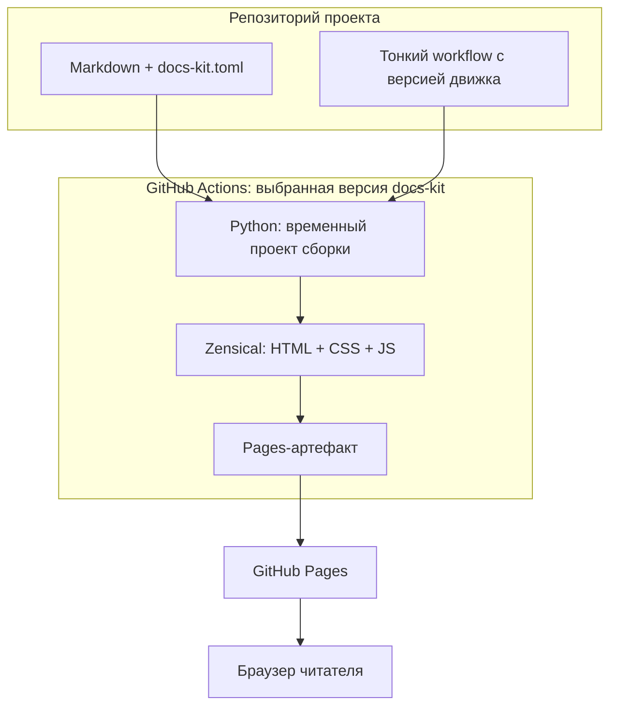

# Архитектура Quokki

## Кратко

Три границы: репозиторий проекта хранит содержание, версионируемый движок
выполняет сборку в CI, GitHub Pages раздаёт готовую статику читателю.
Базы данных и серверного приложения нет.

## Подробно

На сайте работает только браузерный JavaScript: тема, поиск, диаграммы и
ползунок глубины чтения. Метрики добавляются в HTML при сборке.

## Полностью

У проекта и движка отдельные checkout. SHA движка берётся из определения
reusable job. Таким образом, обновление ветки движка не влияет на проект,
который закрепил старый релиз или SHA.

В движке docs-kit CI проверяет исходники текущего коммита и независимый demo.
После успешного CI на push в `main` отдельный workflow документации собирает
проверенный коммит, вызывая опубликованную версию движка.

Компоненты будущих фаз — модель, docs-check, журнал, статистика — **planned**.
Они будут добавляться перед рендерингом, но сейчас в конвейере отсутствуют.
Агенты обновляют объяснения в Markdown вместе с кодом; автоматического вызова
LLM при сборке нет.

