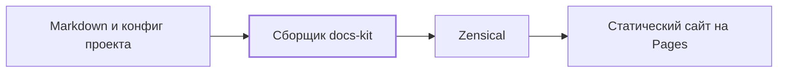

# docs-kit

## Обзор

docs-kit собирает Markdown-документацию проекта в статический сайт.
Проект хранит страницы и конфигурацию, а движок предоставляет сборщик,
общие ассеты и reusable workflow GitHub Actions.

Этот сайт одновременно документирует движок и демонстрирует его подключение.
[Сборка документации](components/build.md) — реализованный компонент фазы 1.

Модель кода, docs-check, журнал и статистика пока не реализованы.
Текущие элементы интерфейса взяты из проверочного стенда; финальная тема
и счётчик слов относятся к фазе 2.

## Как устроено

Одна версия workflow определяет и версию скриптов с темой. Сборка работает
во временном каталоге; исходные страницы не переписываются. Mermaid входит
в готовую статику, поэтому чтение диаграмм не требует обращения к CDN.

## Детали

- [Архитектура](architecture/containers.md) описывает границы системы.
- [Подключение](connect.md) содержит конфиг и пример вызова workflow.
- [Фаза 0](phase-0.md) — результаты выбора генератора.
- [Фаза 1](phase-1.md) — результаты проверки сборки и публикации.

Исходники и рабочая инструкция находятся в
[репозитории docs-kit](https://github.com/Rowolfs/docs-kit).
Планы и ограничения отмечаются явно; отсутствие модулей последующих фаз
не означает успешной проверки документации.

