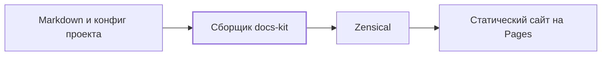

Документация, которой можно доверять

# Quokki

Quokki — имя сайта и системы документации. Репозиторий движка и reusable
workflow сохраняют техническое имя `docs-kit`.

От общего понимания проекта — к устройству компонентов и реальному коду.

## О проекте {#overview}

docs-kit превращает Markdown проекта в единый статический сайт. Проект
хранит содержание и тонкий конфиг; версионируемый движок предоставляет
сборку, оформление и публикацию на GitHub Pages.

Этот сайт описывает движок и одновременно показывает его работу. Начните с
назначения системы, затем выберите глубину ползунком.

### [Как устроена система](architecture/containers.md) {#start-architecture}

Границы проекта, путь от Markdown к сайту и ответственность каждой части.

### [Сборка документации](components/build.md) {#start-build}

Реализованный компонент: подготовка контента, рендеринг и результат сборки.

### [Подключить свой проект](connect.md) {#start-connect}

Конфигурация и workflow для публикации документации вашего репозитория.

### [Принципы документации](documentation-standard.md) {#start-principles}

Понятные объяснения, два независимых измерения и проверяемые требования.

Сборка и публикация реализованы. Модель кода, docs-check, журнал и статистика
запланированы на следующие фазы и пока не входят в движок.

## Путь документации {#documentation-flow}

Одна версия workflow определяет и версию скриптов с темой. Сборка работает
во временном каталоге; исходные страницы не переписываются. Mermaid входит
в готовую статику, поэтому чтение диаграмм не требует обращения к CDN.

## Детали реализации {#reader-details}

Контент остаётся доступным без JavaScript. В готовом сайте нет серверного
приложения: браузер получает HTML, CSS, локальные скрипты и диаграммы.

- [Фаза 0](phase-0.md) — результаты выбора генератора.
- [Фаза 1](phase-1.md) — результаты проверки сборки и публикации.
- [Фаза 2](phase-2.md) — тема, ползунок и метрики текста.

Исходники и рабочая инструкция находятся в
[репозитории docs-kit](https://github.com/Rowolfs/docs-kit).
Статус `implemented` описывает реализованную возможность. Привязка к коммиту
показывает проверенную ревизию; она не заменяет содержательную проверку
объяснения человеком. Отсутствие docs-check пока не означает, что страницы
прошли будущие строгие и мягкие проверки.

